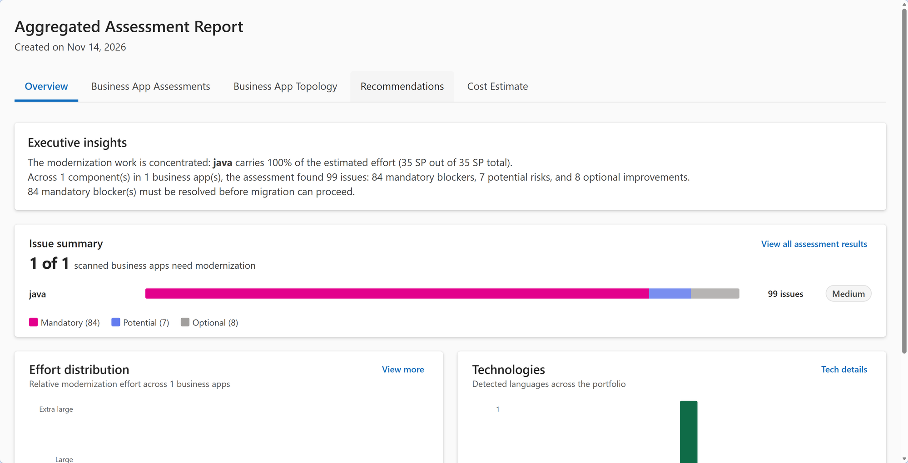

# 2. 평가하고 계획 승인하기

[전체 목차](../../README.md) | [Java 목차](README.md) | [이전: 원본 실행](01-run-locally.md) | [다음: 업그레이드](03-upgrade.md) | [문제 해결](08-troubleshooting.md)

## 목표

앱 소스를 변경하지 않고 현재 구조와 업그레이드 위험을 평가한 뒤, 변경 범위와 제약 조건을 반영한 실행 계획을 작성합니다.

## 실습 전 확인 사항

로컬에서 원본 앱의 동작을 확인하고, 업그레이드 전 앱 상태를 커밋해 둡니다. [실습 1: 원본 앱을 로컬에서 실행하기](01-run-locally.md)에서 사용한 터미널을 계속 사용합니다.

## 앱 평가하기(Assessment)

앱을 평가해 현대화에 필요한 작업과 위험을 파악합니다. [공식 문서](https://learn.microsoft.com/azure/developer/github-copilot-app-modernization/modernization-agent/cli-commands)에 따르면 Modernize CLI는 코드, 설정과 의존성을 분석해 평가 보고서를 만듭니다. 이 실습에서는 보고서를 바탕으로 업그레이드와 클라우드 전환 계획을 세웁니다.

앱 루트에서 Modernize CLI를 실행해 앱 평가를 시작합니다.

```bash
modernize
```

> [!NOTE]
>
> Modernize CLI가 작업에 사용할 모델을 자동으로 선택하게 하려면 실행 후 화면에서 `M` 키를 눌러 `Auto`를 선택합니다.

다음과 같이 `auto` 모델을 지정해 실행할 수도 있습니다.

```bash
modernize --model auto
```

화면에 표시되는 항목과 선택값은 다음과 같습니다. UI 표기는 설치된 버전에 따라 다를 수 있습니다.

| 항목 | 선택값 |
| --- | --- |
| How would you like to modernize your app? | Assess |
| Choose source type | Current folder |
| Select assessment domains | Upgrade, Cloud Readiness, Security |
| Analysis Coverage | Full analysis |
| Minimum CVE Severity | High |
| Target Runtime | OpenJDK 25 |
| Target Compute Services | Azure Container Apps (ACA) |
| Target Operating System | Linux |
| Containerization | Enabled |
| Continue? | Continue |
| How would you like to assess? | Assess locally |
| Additional assessment context |  |
| Enter output path | 기본값 |

평가가 끝나면 다음 화면에서 계획을 바로 생성하지 않고 메인 메뉴로 돌아갑니다.

| 항목 | 선택값 |
| --- | --- |
| How would you like to continue? | Return to main menu |

`java/.github/modernize/assessment` 아래에 생성된 평가 보고서를 열어 검토합니다.

```text
방금 `java/.github/modernize/assessment` 디렉터리에 생성된 평가 보고서를 열어줘
```



## 지침 만들기(Rulebook)

Rulebook은 현대화 과정에서 지킬 기준을 담은 지침입니다. [공식 문서](https://learn.microsoft.com/azure/developer/github-copilot-app-modernization/modernization-agent/overview)에서 설명하듯, 조직의 현대화 표준을 지침으로 만들어 여러 앱과 저장소에 재사용할 수 있습니다. 이 실습에서는 워크숍 기준 문서를 바탕으로 계획과 실행에 적용할 지침을 만듭니다.

화면에 표시되는 항목과 선택값은 다음과 같습니다. UI 표기는 설치된 버전에 따라 다를 수 있습니다.

| 항목 | 선택값 또는 입력값 |
| --- | --- |
| How would you like to modernize your app? | Rulebook |
| Create a rulebook | 선택 |
| Source | `../docs/java/modernize-rulebook-source.md` |
| Use default templates | 선택 안 함 |
| Push to Git URL | 입력하지 않음 |
| 실행 | Generate modernization rulebook from source document |

`java/.github/modernize/rulebook` 아래에 생성된 현대화 지침을 열어 검토합니다.

> [!CAUTION]
>
> 현대화 지침은 작업 기준일 뿐, 운영체제 권한을 제한하거나 비용 발생을 막는 보안 장치는 아닙니다.

## 계획 문서 만들기(Plan)

평가 결과와 현대화 목표를 바탕으로 작업 순서와 성공 기준을 정합니다. [공식 문서](https://learn.microsoft.com/azure/developer/github-copilot-app-modernization/modernization-agent/overview)에 따르면 계획은 실행 전에 검토하고 다듬을 수 있습니다. [CLI 명령 참조](https://learn.microsoft.com/azure/developer/github-copilot-app-modernization/modernization-agent/cli-commands)는 자연어로 입력한 목표와 평가 보고서를 바탕으로 `plan.md`와 `tasks.json`을 만든다고 안내합니다. 이 실습에서는 앞서 만든 지침도 함께 반영해 계획을 작성하고 검토합니다.

화면에 표시되는 항목과 선택값은 다음과 같습니다. UI 표기는 설치된 버전에 따라 다를 수 있습니다.

| 항목 | 선택값 |
| --- | --- |
| How would you like to modernize your app? | Plan |
| Choose source type | Current folder |
| How would you like to deliver the plan? | Keep the plan local |
| Select an assessment report to include (optional) | 생성된 평가 보고서 |
| Create modernization plan / Plan name | modernization-plan (기본값) |
| Create modernization plan / Prompt | 아래 프롬프트 참조 |

`Create modernization plan`의 프롬프트 입력 화면에 다음 내용을 입력합니다.

```text
`.github/modernize/rulebook/`에 생성된 현대화 지침과 평가 보고서를 읽고
Java 앱을 Linux Azure Container Apps로 현대화하는 하나의 계획을 작성해 줘.
지금은 계획만 작성하고 실행하지 마.

Java 8 기준 테스트 보강과 검증, JDK 25 업그레이드와 로컬 회귀 테스트,
Azure 서비스 연동 코드와 단위 테스트, azd 배포 산출물 준비를 순서대로 포함해 줘.
각 단계의 검증이 실패하면 다음 단계로 진행하지 않도록 해 줘.
기존 web/worker 동작과 dev/S3 차이를 보존하고 Spring Boot와 라이브러리의
호환성, 버전 근거, 변경 파일과 중단/복구 기준을 명시해 줘.

PostgreSQL은 Flexible Server, RabbitMQ는 Service Bus,
로컬 파일과 S3는 비공개 Blob으로 이전하도록 계획해 줘.
관리 ID, 최소 권한, 메시지 처리와 파일 조회 동작을 유지해 줘.
Dockerfile, azure.yaml, Bicep과 별도 DB 초기화 절차를 준비하고
이미지는 로컬 엔진으로 빌드하도록 해 줘.
실제 Azure 리소스 생성, DB 변경/데이터 이전, 이미지 게시와 배포는
실행 작업에서 제외하고 참가자가 azd로 진행할 별도 절차로 정리해 줘.
```

이후 에이전트가 질문하면 내용을 읽고 권장 옵션을 선택하거나 직접 답변합니다.

`.github/modernize/modernization-plan` 아래에 생성된 `plan.md`와 `tasks.json`을 열어 검토합니다.

## 생성 문서 커밋하기

앱 루트에서 평가 보고서, 현대화 지침, `plan.md`, `tasks.json`만 스테이징합니다. 커밋할 변경을 검토하고 앱 외부 파일이나 비밀정보가 있으면 제외합니다.

```bash
git add .github/modernize/assessment .github/modernize/rulebook .github/modernize/modernization-plan/plan.md .github/modernize/modernization-plan/tasks.json
git status --short
git diff --cached --stat
git diff --cached
```

검토를 마친 뒤 문제가 없을 때만 커밋합니다.

```bash
git commit -m "Modernize: add assessment and plan"
```

## 완료 및 다음 단계

- [ ] 지침 파일의 실제 생성 경로를 기록하고 검토했습니다.
- [ ] `plan.md`와 `tasks.json`의 실제 생성 경로를 기록하고 함께 검토했습니다.
- [ ] 기준 테스트, 업그레이드, Azure 코드와 azd 산출물이 하나의 계획에 순서대로 포함되어 있습니다.
- [ ] 외부 도구 설치나 비용 발생 작업, Azure/DB 변경이 계획 실행에 포함되지 않았습니다.
- [ ] 테스트 조건, 파일 범위와 중단/복구 기준이 명확합니다.
- [ ] 계획 범위를 바꿨다면 `plan.md`와 `tasks.json`을 함께 수정하고 다시 검토했습니다.
- [ ] 평가 보고서, 현대화 지침, `plan.md`, `tasks.json`을 커밋하고 앱 외부 파일과 비밀정보는 제외했습니다.

위 항목을 모두 마쳤다면 다음 단계인 [3. JDK 25로 업그레이드하기](03-upgrade.md)로 이동해 Modernize CLI의 `Execute` 메뉴로 계획을 실행합니다.
