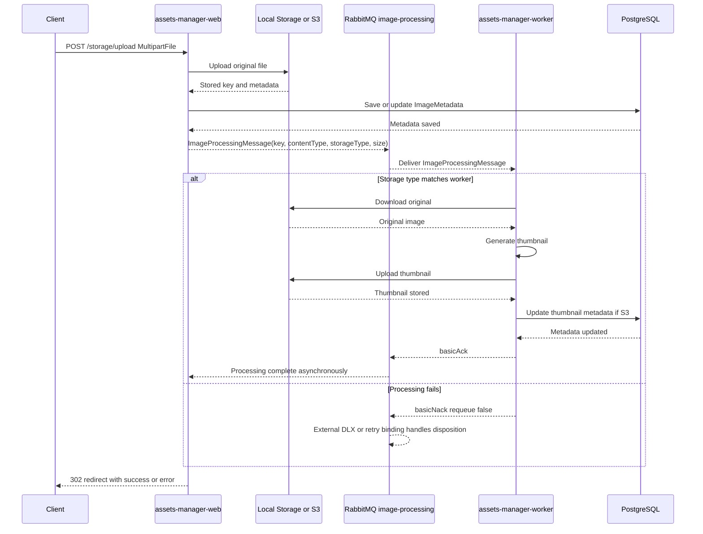

# API & Service Communication Contracts

The application exposes a small browser-oriented HTTP API of 7 routes and uses asynchronous RabbitMQ messaging to offload thumbnail generation between the web module and worker module.

## Service Catalog

| Service | Port | Category | Purpose |
|---|---:|---|---|
| assets-manager-web (`web`) | Spring Boot default 8080 | API Layer / Business | Serves Thymeleaf pages and file upload, viewing, listing, and deletion endpoints; publishes image-processing messages. |
| assets-manager-worker (`worker`) | Spring Boot default 8080 unless overridden; no HTTP routes | Business | Consumes image-processing messages and creates thumbnails in local or S3 storage. |
| RabbitMQ | 5672 | Infrastructure | External message broker for the durable `image-processing` queue. |
| PostgreSQL | 5432 | Infrastructure | External persistence store for image metadata in non-development profiles. |
| AWS S3 | External HTTPS endpoint | Infrastructure | External object storage selected by the non-development profile. |

## API Endpoints Inventory

| Service | Method | Path | Request Type | Response Type |
|---|---|---|---|---|
| assets-manager-web / `HomeController` | GET | `/` | None | 302 redirect to `/storage` (Thymeleaf `String` redirect) |
| assets-manager-web / `S3Controller` | GET | `/storage` | None | 200 Thymeleaf `list` view with `S3StorageItem` collection |
| assets-manager-web / `S3Controller` | GET | `/storage/upload` | None | 200 Thymeleaf `upload` view |
| assets-manager-web / `S3Controller` | POST | `/storage/upload` | Multipart `file` (`MultipartFile`) | 302 redirect to `/storage/upload` or `/storage`; flash result attributes |
| assets-manager-web / `S3Controller` | GET | `/storage/view-page/{key}` | Path parameter `key` (`String`) | 200 Thymeleaf `view` view or 302 redirect to `/storage` |
| assets-manager-web / `S3Controller` | GET | `/storage/view/{key}` | Path parameter `key` (`String`) | 200 `InputStreamResource` as `application/octet-stream`; 404 if the object cannot be opened |
| assets-manager-web / `S3Controller` | POST | `/storage/delete/{key}` | Path parameter `key` (`String`) | 302 redirect to `/storage`; flash success or error attribute |

## Management & Observability Endpoints

| Service | Endpoint | Custom Metrics (if any) |
|---|---|---|
| assets-manager-web | None identified | None identified |
| assets-manager-worker | None identified | None identified |

No Spring Boot Actuator dependency or explicit Actuator, health, metrics, Prometheus, or custom Micrometer endpoint is configured.

## DTOs & Contracts

`ImageProcessingMessage` is the asynchronous contract exchanged by the web and worker modules. It is a service-level mutable Lombok DTO with `key`, `contentType`, `storageType`, and `size`; Jackson serializes the RabbitMQ payload as JSON. `S3StorageItem` is a mutable Lombok view-model/response DTO used to render the storage list. `ImageMetadata` is the service-level JPA entity used for persistence metadata; it is owned by the web and worker modules and has its field details documented in `data-architecture.md`. There is no gateway aggregation DTO or OpenAPI/Swagger specification in the source. Protobuf and GraphQL schemas are not present.

## Communication Patterns

- **Synchronous:** Browser-to-Thymeleaf HTTP calls are handled directly by Spring MVC. The web module calls local storage or AWS S3 synchronously and calls PostgreSQL through JPA in the S3 profile. There are no inter-service REST, gRPC, or gateway calls.
- **Asynchronous:** Upload processing publishes `ImageProcessingMessage` to the durable RabbitMQ `image-processing` queue using `RabbitTemplate.convertAndSend`. The web module and worker module both listen on the queue; only the processor whose `storageType` matches its active implementation handles the work. `BackupMessageProcessor` is an optional profile-specific listener that acknowledges monitoring messages.
- **Storage profiles:** `dev` selects local filesystem storage and `LocalFileProcessingService`; other profiles select AWS S3 and `S3FileProcessingService`.
- **Message acknowledgment:** Processing success produces `basicAck`; worker processing failure produces `basicNack(deliveryTag, false, false)`. Source comments describe routing to a dead-letter exchange/delayed retry, but no dead-letter exchange, retry queue, retry count, delay, timeout, or Redelivery configuration is explicitly declared.
- **Resilience:** No circuit breaker, Resilience4j, Spring Retry, bulkhead, explicit HTTP timeout, client retry policy, or fallback is implemented. RabbitMQ uses manual acknowledgments; failed worker messages are rejected without requeue, with the intended retry behavior dependent on externally configured broker exchange bindings.
- **Discovery:** No service-discovery client or API gateway is present. RabbitMQ and PostgreSQL use configured hostnames or defaults; no Eureka, Consul, Kubernetes DNS, or client-side load balancing is identified.
- **Startup:** The web and worker services are independent Spring Boot applications that should be started after RabbitMQ and PostgreSQL/storage dependencies are available. No readiness probes or startup waits are configured in the modules.
- **Security:** No authentication or authorization is implemented at the MVC API; the endpoints are publicly accessible and no role or permission checks are present. No HTTPS/TLS, OAuth2/JWT, Basic Auth, or Spring Security dependency is configured. RabbitMQ, database, and S3 credentials are externalized in properties, but HTTPS/S3/TLS behavior for the transport is not declared in application code.
- **Gateway aggregation:** No API gateway or downstream service composition is present.

## Service Technology Matrix

| Service | Web | Data Access | Discovery | Gateway | Actuator | Cache | Metrics |
|---|---|---|---|---|---|---|---|
| assets-manager-web | Spring MVC / Thymeleaf | JPA / PostgreSQL | None | None | None | None | None |
| assets-manager-worker | RabbitMQ listener only | JPA / PostgreSQL (S3 mode) | None | None | None | None | None |

## Service Communication Sequence

