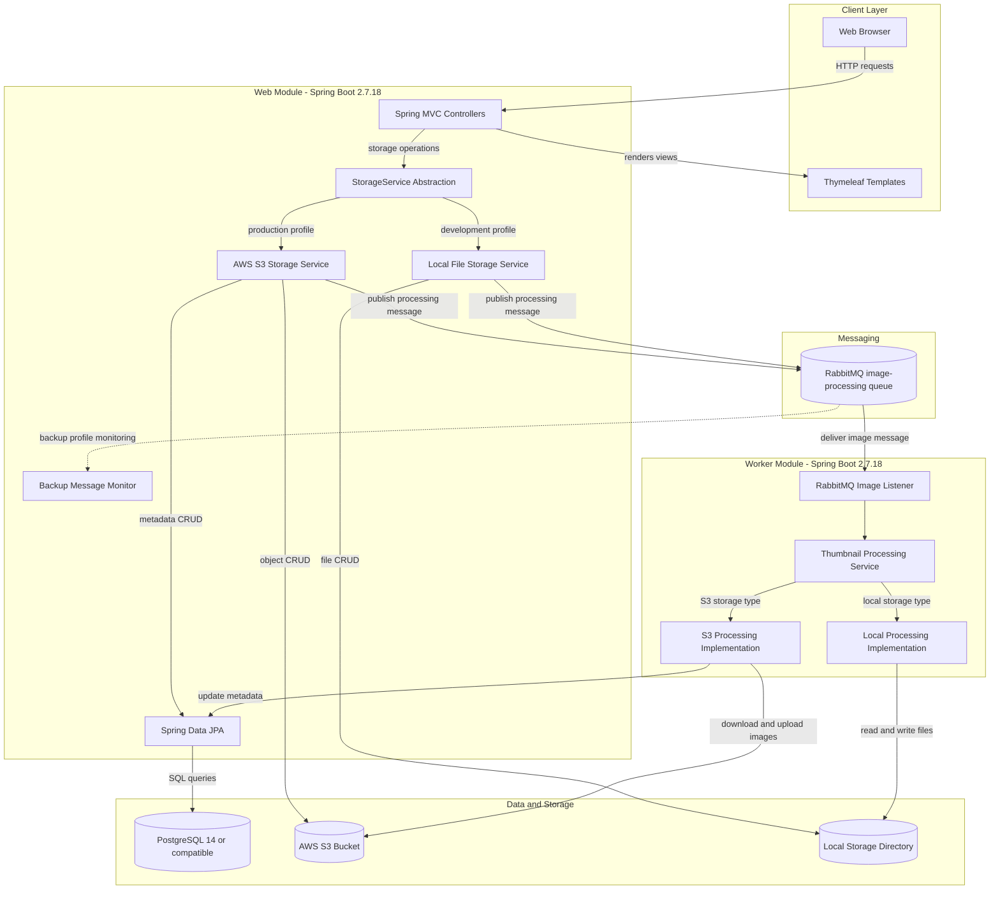
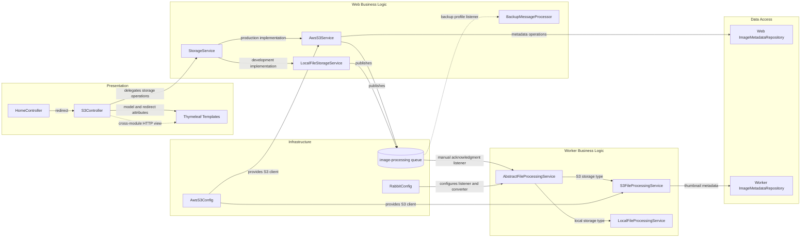

# Architecture Diagram

This Java application is a multi-module assets manager that provides a Spring MVC web interface and an asynchronous worker for generating image thumbnails. It supports AWS S3 or local filesystem storage through profile-specific implementations.

## Application Architecture

### Technology Stack Summary

| Layer | Technology | Version | Purpose |
|---|---|---|---|
| Parent build | Maven | 4.0.0 model | Builds the web and worker modules |
| Runtime | Java | 8 | Application language and runtime |
| Application framework | Spring Boot | 2.7.18 | Web, messaging, worker, and configuration support |
| Presentation | Spring MVC and Thymeleaf | Managed by Spring Boot | Server-side pages and asset views |
| Data access | Spring Data JPA and Hibernate | Managed by Spring Boot | Image metadata persistence |
| Database | PostgreSQL JDBC | PostgreSQL driver | Stores image metadata |
| Messaging | Spring AMQP and RabbitMQ | Spring Boot managed | Distributes thumbnail jobs |
| Object storage | AWS SDK for Java | 2.25.13 | S3 object operations |
| Image processing | Java Image I/O | JDK 8 | Thumbnail scaling and sharpening |

### Data Storage & External Services

PostgreSQL stores image metadata such as filename, content type, size, S3 key, and thumbnail key. AWS S3 is the production object store, while the dev profile uses a local filesystem directory. RabbitMQ provides the image-processing queue that decouples uploads from thumbnail generation.

### Key Architectural Decisions

- Uses the StorageService interface with S3 and local filesystem implementations selected by Spring profiles.
- Uses RabbitMQ and manual acknowledgments to decouple web uploads from asynchronous thumbnail processing.
- Uses Spring Data JPA repositories for metadata while object data remains in S3 or the local filesystem.

## Component Relationships

### Component Inventory

| Component | Layer | Type | Responsibility |
|---|---|---|---|
| HomeController | Presentation | MVC Controller | Redirects the application root to the storage page |
| S3Controller | Presentation | MVC Controller | Lists, uploads, views, and deletes stored objects |
| Thymeleaf Templates | Presentation | View | Renders list, upload, and view pages |
| StorageService | Web Business Logic | Service interface | Defines provider-neutral storage operations |
| AwsS3Service | Web Business Logic | Storage service | Implements S3 upload, download, listing, deletion, and metadata updates |
| LocalFileStorageService | Web Business Logic | Storage service | Implements storage operations against the local filesystem |
| BackupMessageProcessor | Web Business Logic | Rabbit listener | Optionally monitors and acknowledges processing messages |
| AbstractFileProcessingService | Worker Business Logic | Listener and processor base | Receives jobs, creates thumbnails, and handles acknowledgments |
| S3FileProcessingService | Worker Business Logic | Storage processor | Downloads originals and uploads thumbnails in S3 |
| LocalFileProcessingService | Worker Business Logic | Storage processor | Reads originals and writes thumbnails locally |
| Web ImageMetadataRepository | Data Access | JPA Repository | Persists and retrieves web-module image metadata |
| Worker ImageMetadataRepository | Data Access | JPA Repository | Updates thumbnail metadata in the worker module |
| RabbitConfig | Infrastructure | Spring configuration | Declares the durable queue and JSON manual-ack listener |
| AwsS3Config | Infrastructure | Spring configuration | Builds the AWS S3 client from application settings |
| image-processing queue | Infrastructure | RabbitMQ Queue | Carries image processing messages from web module to worker |
