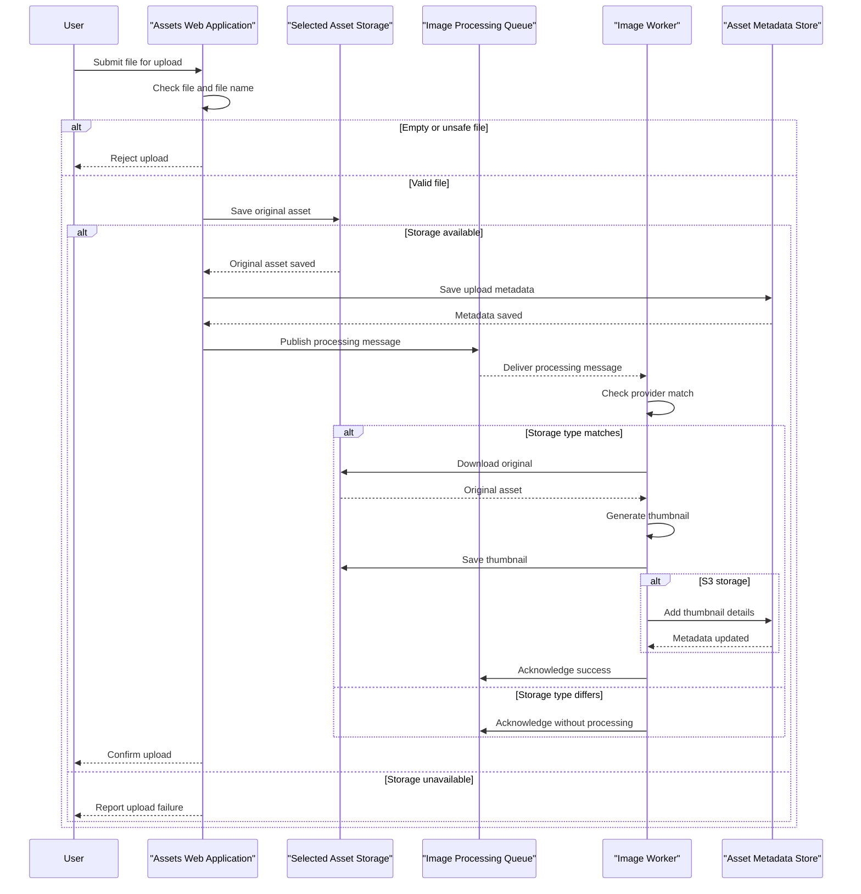

# Core Business Workflows

The application lets users store, browse, download, delete, and generate thumbnails for images across local filesystem or AWS S3 storage. It coordinates upload processing between a web application and a background worker through a durable message queue.

## Domain Entities

| Entity | Service / Bounded Context | Description | Key Relationships |
|---|---|---|---|
| ImageMetadata | Web and Worker / Asset Metadata | Records an uploaded asset and the lifecycle information for its original and thumbnail representations. | References the original asset and optional thumbnail by storage key and URL. |
| ImageProcessingMessage | Web and Worker / Asynchronous Image Processing | Carries the asset key and storage context needed for background thumbnail processing. | References the original asset in ImageMetadata or storage. |
| S3StorageItem | Web / Asset Catalog | Presentation view of an asset, including its name, size, timestamps, and access URL. | Aggregates storage details with optional upload metadata. |

## Service-to-Domain Mapping

| Service | Domain Context | Owned Entities | External Dependencies |
|---|---|---|---|
| Assets Web Application | Asset management and catalog | S3StorageItem, ImageMetadata | Selected storage provider, PostgreSQL repository in non-development execution, RabbitMQ |
| LocalFileStorageService | Local asset storage | S3StorageItem | Local filesystem; RabbitMQ |
| AwsS3Service | Cloud asset storage | S3StorageItem, ImageMetadata | AWS S3; PostgreSQL repository; RabbitMQ |
| Worker Application | Image processing | ImageProcessingMessage, ImageMetadata | RabbitMQ; selected storage provider; PostgreSQL repository in S3 mode |
| RabbitMQ image-processing queue | Cross-context asynchronous processing | ImageProcessingMessage | Durable queue with manual acknowledgments |

The web application is the source of truth for upload initiation and asset metadata. Storage is the source of truth for asset bytes, while PostgreSQL is the source of truth for S3 upload metadata. The worker consumes storage-independent event data and updates S3 metadata after producing a thumbnail.

## Primary Workflows

### Workflow 1: Upload and asynchronously process an image

The user submits a file through the asset upload page. The web controller rejects an empty file, otherwise the active storage service stores the original and publishes an image-processing message containing the key, content type, storage type, and size. The controller then confirms success or reports an I/O failure.

In S3 mode, the original is written to the configured bucket, metadata is persisted, and the queue receives the processing request. In development mode, the original is written to the local directory and the same queue receives the request. The worker validates that the message storage type matches its own provider; matching workers download the original, create a thumbnail, and store it back in the same provider. S3 mode also records the thumbnail key and URL in metadata.

### Workflow 2: Browse and view assets

The user opens the asset list or selects an asset. The web application lists files from the active provider, enriches S3 entries with persisted upload timestamps when metadata exists, and prepares each item for viewing. Missing or unreadable asset states are handled as an empty list or an error response where appropriate.

### Workflow 3: Delete an asset and its thumbnail

The user submits a deletion request. The active storage service deletes the original and attempts to delete the derived thumbnail. S3 mode removes matching metadata after deleting storage objects; local mode removes the matching thumbnail if present. The web application reports success or a failure message and returns to the asset catalog.

### Other Workflows

Backup-profile processing can monitor image-processing messages and acknowledge or requeue them, but it does not modify asset storage or metadata.

## Cross-Service Data Flows

The web application and worker exchange `ImageProcessingMessage` through the `image-processing` RabbitMQ queue. The web application publishes the storage key and provider type after the original file is saved. The worker filters by provider type, downloads the original through the same provider, generates the thumbnail, and uploads the derived image. In S3 mode, the worker cross-references metadata by original S3 key and updates thumbnail fields. RabbitMQ manual acknowledgments complete the flow only after processing succeeds or after the message is deliberately classified as a non-processing match.

If thumbnail processing fails, the worker rejects the message without requeueing it. The comment in the implementation indicates it is intended to be routed to a dead-letter exchange for delayed retry, subject to the external broker topology. If the processing message belongs to another storage provider, the worker acknowledges it without processing. There is no application-level fallback that recreates a missing thumbnail during viewing.

## Business Workflow Sequence

## Business Rules & Decision Logic

### Business Rules

- Uploading an empty multipart file is rejected; the user is redirected to the upload form with an error.
- Upload paths prohibit directory traversal names containing `..` in local mode.
- Uploaded assets retain the original filename for display in local mode or receive a UUID-prefixed key in S3 mode.
- Uploads are limited by multipart file and request settings of 10 MB each.
- Thumbnail dimensions use a maximum of 600 pixels on the longest side while preserving aspect ratio; images already smaller than these dimensions are not enlarged.
- JPEG thumbnails use 95 percent compression quality. PNG thumbnails use Deflate with zero compression quality for maximum fidelity.
- A worker processes a message only when the message storage type matches the worker's configured provider.
- Asset deletion removes both the original and the derived thumbnail when present.
- S3 deletion removes matching persisted metadata after storage removal.
- Local mode does not persist `ImageMetadata`; it derives catalog timestamps from filesystem attributes.

### State and Processing Logic

- A processing event begins as `Pending` by implication in RabbitMQ and becomes successfully acknowledged when the thumbnail is produced or the message is irrelevant to the provider.
- A processing failure is represented by rejection without requeue, with the external broker responsible for delayed retry routing if dead-letter infrastructure is configured.
- `ImageMetadata` sets upload and modification timestamps during JPA lifecycle callbacks.

### Cross-Cutting Concerns

- Transactions are not explicitly declared with `@Transactional`; metadata and storage operations are performed as separate steps.
- Storage success followed by queue or metadata failure can leave the asset stored without complete processing or catalog metadata.
- The application uses manual RabbitMQ acknowledgment, JSON message conversion, and durable queue declarations.
- The backup profile listens to the processing queue for monitoring only. It requeues messages if acknowledgment handling fails.
- Business-level authorization is not implemented in the reviewed controllers or services.
