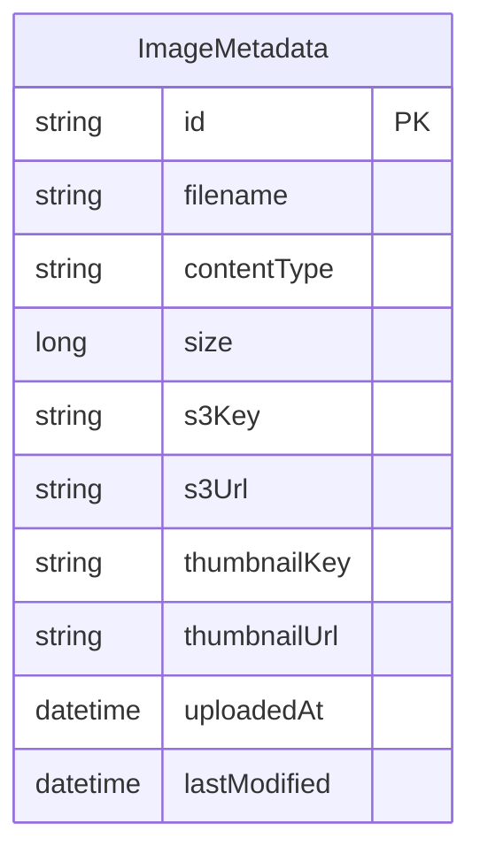

# Data Architecture & Persistence Layer

The Java project uses Spring Data JPA with one persisted entity, `ImageMetadata`, shared across the web and worker modules through a PostgreSQL database.

## Database Configuration

| Service/Module | DB Type | Profile | Driver | Connection | Migration Tool |
|---|---|---|---|---|---|
| Web | PostgreSQL | Default/non-`dev` | `org.postgresql:postgresql` runtime driver | JDBC URL to local PostgreSQL database; credentials and pooling are from Spring/JPA defaults | None detected |
| Worker | PostgreSQL | Default/non-`dev` | `org.postgresql:postgresql` runtime driver | JDBC URL to local PostgreSQL database; credentials and pooling are from Spring/JPA defaults | None detected |
| Web | PostgreSQL configuration remains present; local filesystem is active for storage | `dev` | `org.postgresql:postgresql` runtime driver | JDBC URL to local PostgreSQL database; Hibernate schema update mode remains configured | None detected |
| Worker | PostgreSQL configuration remains present; local filesystem is active for storage | `dev` | `org.postgresql:postgresql` runtime driver | JDBC URL to local PostgreSQL database; Hibernate schema update mode remains configured | None detected |

Both modules use Hibernate through `spring-boot-starter-data-jpa`. The PostgreSQL dialect is explicit, Hibernate is allowed to update the schema, and no Flyway, Liquibase, schema SQL, or seed data was found. Connection details come from the application properties. Spring Boot's default HikariCP pool is available, but no pool size or explicit timeout settings are configured. Configuration inventory details are maintained in `configuration-inventory.md`.

## Data Ownership per Service

| Service | Tables Owned | ORM Framework | Caching | Notes |
|---|---|---|---|---|
| Web | `ImageMetadata` | Spring Data JPA / Hibernate | None detected | Creates and lists metadata; shares the table with the worker |
| Worker | `ImageMetadata` | Spring Data JPA / Hibernate | None detected | Updates thumbnail key and URL; shares the table with the web module |

## Entity Model

`ImageMetadata` is declared in both module packages: `web/src/main/java/com/microsoft/migration/assets/model/ImageMetadata.java` and `worker/src/main/java/com/microsoft/migration/assets/worker/model/ImageMetadata.java`. Both use JPA `@Entity` and `@Id`; `id` is a string UUID. Lifecycle callbacks set `uploadedAt` and `lastModified` before insert/update. No bidirectional or foreign-key relationships are defined.

No explicit `@Transactional`, transaction template, or transaction scope annotation/configuration was found. Repository operations therefore rely on Spring Data JPA's default transaction behavior.

## Key Repository Methods

| Service | Repository | Notable Methods | Purpose |
|---|---|---|---|
| Web | `com.microsoft.migration.assets.repository.ImageMetadataRepository` | Inherits standard `JpaRepository<ImageMetadata, String>` CRUD methods: `findAll`, `findById`, `save`, `deleteById`, and related operations | Persist uploads, load metadata, and delete metadata; no custom derived or `@Query` methods |
| Worker | `com.microsoft.migration.assets.worker.repository.ImageMetadataRepository` | Inherits standard `JpaRepository<ImageMetadata, String>` CRUD methods: `findAll`, `findById`, `save`, `deleteById`, and related operations | Update thumbnail metadata after processing; no custom derived or `@Query` methods |

The web and worker services use `findAll()` and filter in memory for matching `s3Key` values. This is a local in-process lookup pattern rather than a reusable bulk repository query.

## Caching Strategy

| Cache Area | Provider | Configuration | Pattern and Rationale |
|---|---|---|---|
| Metadata lookups | None detected | No cache dependencies or cache annotations are present | Uses direct JPA and in-memory filtering of `findAll()` results; no caching or TTL policy is configured |
| HTTP/query or Hibernate second-level cache | None detected | No cache provider or second-level cache settings are configured | No explicit cache-aside, read-through, write-through, or write-behind behavior is implemented |

## Data Ownership Boundaries

The application uses one logical PostgreSQL database, `assets_manager`, shared by the web and worker modules rather than database-per-service isolation. Both modules contain the same JPA entity mapping and repository type, and both can read and write `ImageMetadata`. The web module creates metadata records for uploaded objects; the worker module updates records with thumbnail keys and URLs. Non-dev storage is S3, while `dev` storage is the local filesystem; file/object content is external to PostgreSQL, and only metadata is persisted there.

RabbitMQ is used for asynchronous image-processing handoff, but metadata access is coordinated through the shared database rather than a service API or dedicated cross-service aggregation query. Both modules perform full-table `findAll()` calls and then filter for matching keys, so the current read pattern is centralized and inefficient for large datasets. No CQRS or separate read/write models are implemented.

### Data Classification & Sensitivity

| Entity | Sensitive Fields | Classification | Controls in Place |
|---|---|---|---|
| `ImageMetadata` | `filename`, `s3Key`, `s3Url`, `thumbnailKey`, `thumbnailUrl` | Potential PII; not explicitly confirmed for PHI or PCI | No field-level encryption, masking, or access-control configuration detected; storage is the responsibility of PostgreSQL and its external database configuration |

No PCI or confirmed health information was found in the entity model. No encryption-at-rest or masking configuration is present in the project source for metadata fields.
