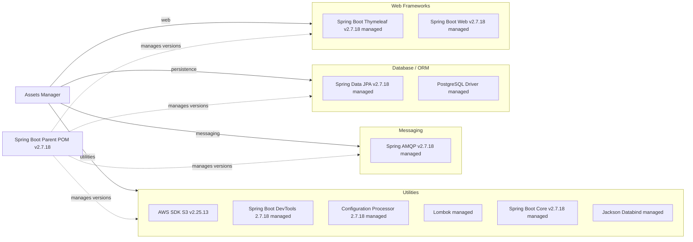

# Dependency Map

A brief dependency inventory for the assets-manager Java application, covering 11 unique declared runtime dependencies across the web and worker modules.

## Dependencies

### Dependency Summary

| Category | Count | Key Libraries | Notes |
|---|---:|---|---|
| Web Frameworks | 2 | Thymeleaf starter, Spring Web starter | Shared web rendering and MVC stack for the web module |
| Database / ORM | 2 | Spring Data JPA, PostgreSQL JDBC driver | Runtime persistence stack; PostgreSQL driver scope is runtime |
| Messaging | 1 | Spring AMQP starter | RabbitMQ-style messaging support in both modules |
| Utilities | 6 | AWS SDK S3, Lombok, Jackson Databind, Spring Boot devtools | Includes cloud storage, serialization, runtime tooling, and build aids |

### Version & Compatibility Risks

Spring Boot 2.7.18 and Java 8 are the central modernization constraints. Spring Boot 2.7 reached end-of-open-source-support status and should be migrated to a supported Boot and Java baseline. The AWS S3 SDK is explicitly managed as 2.25.13, while PostgreSQL, Jackson, Lombok, Thymeleaf, Spring Web, JPA, AMQP, and other Spring libraries are resolved through the Spring Boot parent BOM, so exact managed versions should be confirmed from a Maven dependency report or lock output before upgrade work.

### Notable Observations

- Spring AMQP, AWS SDK S3, Spring Data JPA, and the PostgreSQL driver are used across multiple modules and should be modeled as shared dependencies.
- The web module contains all user-facing frameworks; the worker module relies on core Spring Boot, AMQP, JPA, AWS S3, and Jackson.
- Lombok and Spring Boot DevTools are optional tooling dependencies rather than required application runtime services.
- No Gradle lockfile or Maven lockfile is declared, so transitive dependency versions are not fixed in the repository build files.

## Test Dependencies

| Framework | Version | Notes |
|---|---|---|
| Spring Boot Starter Test | 2.7.18 managed | Declared in both web and worker modules; transitively provides JUnit, Spring Test, Mockito, and other test support |

Total test-scope dependencies: 1 unique starter

Both modules share the same Spring Boot test starter. The POMs do not declare an integration-test framework or Testcontainers explicitly; test infrastructure coverage should be verified from the source test suite.
