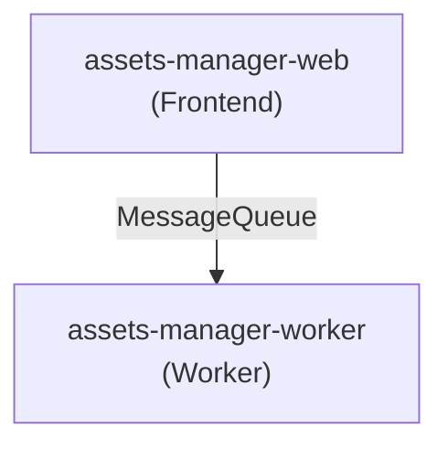

# Topology Graph: java

Analyzed 2 service(s) across 1 repository for application "java" on 2026-11-23 02:19 UTC.

## Services

## Service Details

| Service | Role | Language | Source Repository |
|---------|------|----------|------------------|
| assets-manager-web | Frontend | java | java |
| assets-manager-worker | Worker | java | java |

## Service Dependencies

| Service | Depends On | Dependency Type | Evidence |
|---------|-----------|-----------------|----------|
| assets-manager-web | assets-manager-worker | MessageQueue | `web/src/main/java/com/microsoft/migration/assets/config/RabbitConfig.java: IMAGE_PROCESSING_QUEUE = "image-processing"` |
